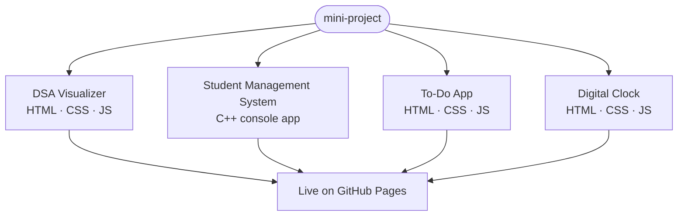

# Mini-Projects

[](https://pawanriko.github.io/mini-project/)


[](https://skillicons.dev)

Small projects I built while learning web development and C++. Each one is in its own folder and each one taught me something different.

## What's inside



## The projects

### 1. DSA Visualizer
A web page that shows how data structures and algorithms actually move, step by step. Reading about sorting is one thing, watching it happen is much easier to understand.
- **Tech:** HTML, CSS, JavaScript
- **Folder:** [`DSA Visualizer/`](https://github.com/pawanriko/mini-project/tree/main/DSA%20Visualizer) — open `index.html` to run it
- **Live:** [pawanriko.github.io/mini-project/DSA Visualizer/](https://pawanriko.github.io/mini-project/DSA%20Visualizer/)

### 2. Student Management System
A C++ console app for managing student records. Records are stored in a file (`students.txt`), so they stay saved between runs. There's a screenshot of it running inside the folder.
- **Tech:** C++ (file handling, add/view/update/delete records)
- **Folder:** [`Student Management System/`](https://github.com/pawanriko/mini-project/tree/main/Student%20Management%20System)
- **Live (web version):** [pawanriko.github.io/mini-project/Student Management System/](https://pawanriko.github.io/mini-project/Student%20Management%20System/) — the console app's records, in a browser

### 3. To-Do App
A simple task manager in the browser. Add tasks, manage your day, that's it.
- **Tech:** HTML, CSS, JavaScript
- **Folder:** [`To-Do-App/`](https://github.com/pawanriko/mini-project/tree/main/To-Do-App) — open `index.html` to run it

### 4. Digital Clock
A live digital clock page. Small, but it was good practice for working with time in JavaScript.
- **Tech:** HTML, CSS, JavaScript
- **Folder:** [`Mini-Projects/Digital Clock/`](https://github.com/pawanriko/mini-project/tree/main/Mini-Projects/Digital%20Clock) — open `index.html` to run it

## Running the web projects

Clone the repo, go into the project folder, open `index.html` in a browser:

```bash
git clone https://github.com/pawanriko/mini-project.git
```

— **Pawan Kumar** · [@pawanriko](https://github.com/pawanriko)
